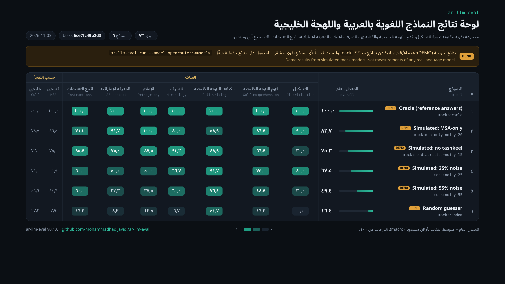
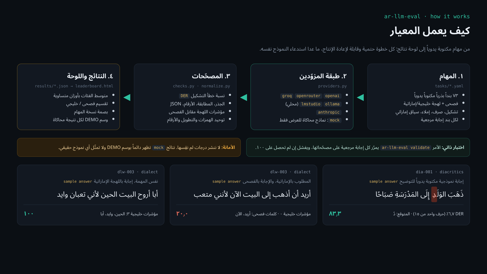

**English** | [العربية](README.md)

# ar-llm-eval: open Arabic and Gulf dialect LLM benchmark

**Evaluate any LLM on Modern Standard Arabic and Emirati/Gulf Arabic with one command: diacritization (tashkeel), morphology, spelling, dialect understanding and dialect *writing*, and UAE context. Grading is deterministic and the output is an RTL HTML leaderboard.**

[](https://github.com/mohammadhadijavidi/ar-llm-eval/actions/workflows/ci.yml)
[](LICENSE)
[](pyproject.toml)



> **Note:** the image above is a real screenshot of the leaderboard, but **every row is DEMO data** from simulated `mock` models. None of it measures a real model. This repo publishes no scores it has not actually measured.

## Why

Before you ship an **Arabic chatbot** or an AI agent for customers in the UAE and the Gulf, you need to know whether the model understands «باچر», «مب» and «يالس في الميلس», whether it can vowel a sentence correctly, and whether it actually answers in Khaleeji when asked or slides back into MSA.

Large academic Arabic benchmarks already exist, among them ArabicMMLU, DialectalArabicMMLU and the Open Arabic LLM Leaderboard. They are the right tool for broad model comparison. **ar-llm-eval** does a different job:

- **You run it on your own model** (OpenAI, OpenRouter, Groq, Anthropic, or a local model through Ollama or LM Studio) in minutes and get a shareable HTML leaderboard.
- **It focuses on the Gulf and the UAE.** It tests dialect comprehension and dialect *generation*, the Emirati ج→ي shift, and local context (5% VAT, AED, the weekend).
- **The graders are deterministic and built for Arabic.** They include letter-aligned diacritic error rate (DER), root extraction with unified hamza seats, strict orthography (hamza, taa marbuta, alef maqsura) and Arabic-Indic digits. A model judges another model's output only where nothing deterministic works.
- **The task set is small, hand-written and extensible.** Tasks live in YAML files, and a self-test guarantees that every reference answer scores 100.

## Features

- **73 hand-written seed items** in 7 categories: 52 MSA and 21 Gulf/Emirati.
- **Diacritization:** per-letter DER. An answer that changes the sentence's letters is rejected. Sukun is optional, and case endings can be ignored.
- **Gulf dialect comprehension:** everyday vocabulary, the ج→ي shift, and Gulf-to-MSA rewriting.
- **Gulf dialect writing:** counts Gulf markers against MSA-only words, which catches models that answer in MSA.
- **Morphology:** roots, patterns (awzan), broken plurals, the dual, conjugation and agreement.
- **Orthography:** hamza seats, taa marbuta, alef maqsura and hamzat al-wasl, compared strictly.
- **UAE context:** stable facts plus local arithmetic (5% VAT, times).
- **Instruction following in Arabic:** JSON with Arabic values, Arabic-Indic digits and word limits.
- **Self-contained RTL HTML leaderboard** with an embedded Noto Sans Arabic font, an MSA/Gulf split, and DEMO tags on simulated runs.
- **A task-version fingerprint** in every result file, so results from different task versions are never mixed silently.
- Minimal dependencies: `httpx` and `PyYAML`.

## Quick start

```bash
pip install git+https://github.com/mohammadhadijavidi/ar-llm-eval.git

# No API key needed: simulated models and a DEMO leaderboard
ar-llm-eval demo --out demo
# open demo/leaderboard.html

# Real evaluation
export OPENROUTER_API_KEY=...
ar-llm-eval run --model openrouter:qwen/qwen-2.5-72b-instruct
ar-llm-eval board results --out leaderboard.html
```

Development:

```bash
git clone https://github.com/mohammadhadijavidi/ar-llm-eval.git && cd ar-llm-eval
pip install -e ".[dev]"
ar-llm-eval validate && pytest -q
```

## Configuration (providers)

Models are addressed as `<provider>:<model>`. Copy `.env.example` to `.env` and fill in only what you use.

| Provider | `--model` example | Env vars |
|---|---|---|
| OpenAI / any OpenAI-compatible API | `openai:gpt-4o-mini` | `OPENAI_API_KEY`, `OPENAI_BASE_URL` (optional) |
| OpenRouter | `openrouter:qwen/qwen-2.5-72b-instruct` | `OPENROUTER_API_KEY` |
| Groq | `groq:llama-3.3-70b-versatile` | `GROQ_API_KEY` |
| Ollama (local) | `ollama:qwen2.5:7b` | `OLLAMA_BASE_URL` (optional) |
| LM Studio (local) | `lmstudio:<model>` | `LMSTUDIO_BASE_URL` (optional) |
| Anthropic | `anthropic:<model>` | `ANTHROPIC_API_KEY` |
| Simulated (offline) | `mock:oracle`, `mock:noisy-25`, `mock:no-diacritics`, `mock:msa-only`, `mock:random` | none |

`mock` models **never call a language model**. Each one builds its answer from the hand-written reference and then damages it in one specific way: it strips diacritics, swaps Gulf words for MSA, or makes seeded random errors. They exist to exercise the runner, graders and leaderboard, and they are always shown as DEMO.

Other settings: `AR_EVAL_TIMEOUT` and `AR_EVAL_RETRIES` (environment variables), plus the `--temperature`, `--max-tokens`, `--concurrency` and `--limit` flags.

## Usage examples

```bash
# Gulf dialect items only
ar-llm-eval run --model groq:llama-3.3-70b-versatile --dialect gulf

# Selected categories
ar-llm-eval run --model ollama:qwen2.5:7b --category diacritics,morphology

# Smoke test: first 3 items per category
ar-llm-eval run --model openai:gpt-4o-mini --limit 3

# Your own tasks
ar-llm-eval run --model mock:oracle --tasks examples/custom_tasks.yaml

# Grade one answer by hand (useful while writing tasks)
ar-llm-eval grade dia-003 "إِنَّ العِلْمَ نُورٌ"

# List categories and self-test the references
ar-llm-eval list
ar-llm-eval validate
```

From Python, see [`examples/run_python.py`](examples/run_python.py). To compare several models, see [`examples/compare_models.sh`](examples/compare_models.sh).

A task item looks like this:

```yaml
- id: dlu-006
  dialect: gulf
  prompt: "«الريال يالس في الميلس». أين الرجل؟"     # "Where is the man?"
  options: {"أ": "في السوق", "ب": "في المجلس", "ج": "في السيارة", "د": "في المسجد"}
  reference: "ب"
  checks: [{type: choice, answer: "ب"}]
  note: "ريال = رجل، يالس = جالس، ميلس = مجلس (Emirati ج→ي)."
```

## How it works



1. **Tasks.** YAML files live in `src/ar_llm_eval/tasks/`. Each item has a hand-written reference answer and a list of checks.
2. **Providers.** A thin layer over `httpx` covers OpenAI-compatible APIs, Anthropic and mock models. It retries only on 429 and 5xx errors.
3. **Graders.** The check types are `exact`, `keywords`, `not_contains`, `regex`, `number`, `choice`, `root`, `diacritics`, `dialect`, `json`, `word_count`, `script`, `similarity` (chrF) and an optional `llm_judge`, which is skipped unless you pass `--judge`. Normalization lives in `normalize.py`, with explicit switches for alef, yaa, taa marbuta, diacritics and digits.
4. **Results.** You get one JSON file per model, with every answer and the reason for every lost point. The overall score is the macro average over categories.
5. **Leaderboard.** One HTML file that works offline.

**Known limitations:** the seed set is small (73 items), so a gap of a few points between two models is not statistically meaningful. The dialect check uses high-precision surface markers; it is not a dialect classifier. The UAE facts were chosen because they are stable, but verify them before relying on them.

## Roadmap

- [ ] More items from native speakers (Saudi, Kuwaiti, Qatari, Bahraini, Omani)
- [ ] A reading comprehension category built on hand-written passages
- [ ] Bootstrap confidence intervals on the leaderboard
- [ ] Multi-sample runs to measure consistency
- [ ] CSV / Markdown export
- [ ] Published real results for open models, with full, verifiable JSON files

## Contributing

New **hand-written items** from Gulf dialect speakers are especially welcome. See [CONTRIBUTING.md](CONTRIBUTING.md). The ground rules: `ar-llm-eval validate` must pass, and nothing may be copied from exams or other benchmarks.

## License

[MIT](LICENSE). The embedded Noto Sans Arabic font is under the SIL Open Font License (`src/ar_llm_eval/web/fonts/OFL.txt`).

---

Built by [Mohammad Hadi Javidi](https://github.com/mohammadhadijavidi) — AI products & automation, Dubai.
