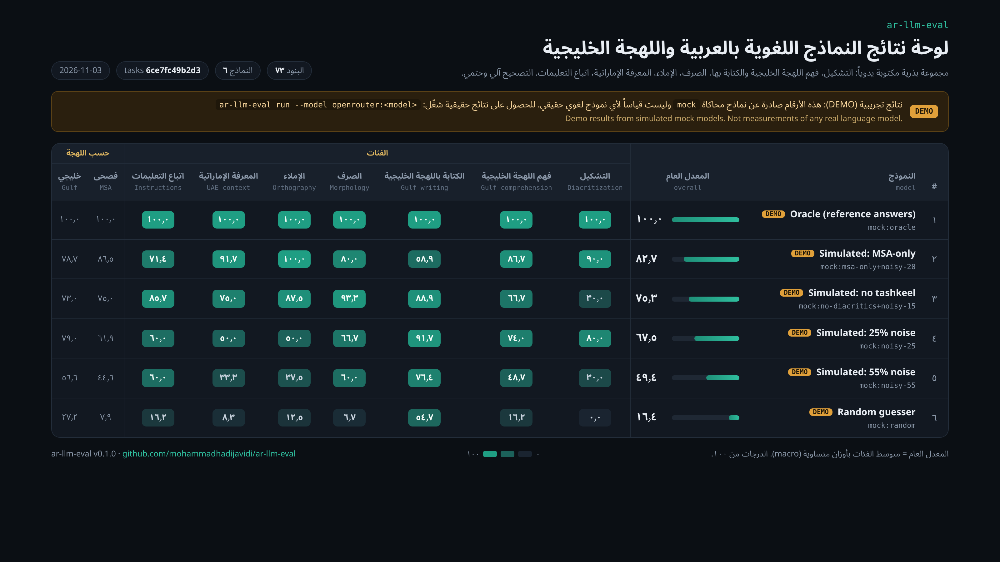
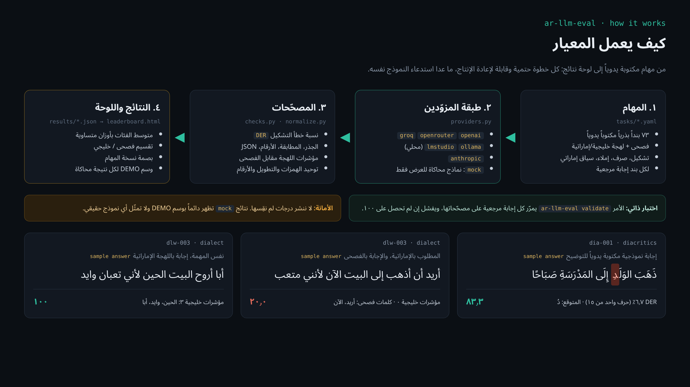

<div dir="rtl">

[English](README.en.md) | **العربية**

# ar-llm-eval: معيار مفتوح لتقييم النماذج اللغوية بالعربية واللهجة الخليجية

**اختبر أي نموذج لغوي (LLM) على العربية الفصحى واللهجة الإماراتية والخليجية بأمر واحد: تشكيل، صرف، إملاء، فهم اللهجة والكتابة بها، ومعرفة إماراتية، مع تصحيح آلي حتمي ولوحة نتائج HTML.**

[](https://github.com/mohammadhadijavidi/ar-llm-eval/actions/workflows/ci.yml)
[](LICENSE)
[](pyproject.toml)



> **تنبيه:** الصورة أعلاه لقطة حقيقية من لوحة النتائج، لكن **كل الصفوف فيها تجريبية (DEMO)** وصادرة عن نماذج محاكاة `mock`، وليست قياساً لأي نموذج حقيقي. هذا المستودع لا ينشر أي درجة لم نقِسها فعلاً.

## لماذا؟

قبل أن تبني **شات بوت عربي** أو وكيل ذكاء اصطناعي (AI agent) لعملاء في الإمارات والخليج، تحتاج أن تعرف: هل يفهم النموذج «باچر» و«مب» و«يالس في الميلس»؟ هل يشكّل الجملة بشكل صحيح؟ هل يرد بالخليجي حين يُطلب منه، أم يعود إلى الفصحى؟

توجد معايير أكاديمية عربية كبيرة ومهمة (مثل ArabicMMLU وDialectalArabicMMLU ولوحة Open Arabic LLM Leaderboard)، وهي ممتازة لمقارنة النماذج على نطاق واسع. أما **ar-llm-eval** فله هدف مختلف:

- **أداة تشغّلها بنفسك على نموذجك** (OpenAI، OpenRouter، Groq، Anthropic، أو نموذج محلي عبر Ollama / LM Studio) في دقائق، وتحصل على لوحة نتائج HTML جاهزة للمشاركة.
- **تركيز على الخليج والإمارات**: فهم اللهجة، و**الكتابة** باللهجة (لا الفهم فقط)، وظاهرة ج←ي الإماراتية، وسياق محلي (ضريبة القيمة المضافة ٥٪، الدرهم، عطلة نهاية الأسبوع).
- **مصحّحات حتمية مصمّمة للعربية**: نسبة خطأ التشكيل (DER) بمحاذاة الحروف، واستخراج الجذر مع توحيد مواضع الهمزة، والإملاء الصارم (همزة، تاء مربوطة، ألف مقصورة)، والأرقام المشرقية. لا «نموذج يحكم على نموذج» إلا عند الضرورة.
- **مجموعة صغيرة مكتوبة يدوياً وقابلة للتوسعة** بملفات YAML، مع اختبار ذاتي يضمن أن كل إجابة مرجعية تحصل على ١٠٠.

## المزايا

- **٧٣ بنداً بذرياً مكتوباً يدوياً** في ٧ فئات: ٥٢ فصحى و٢١ خليجي/إماراتي.
- **التشكيل**: نسبة خطأ تشكيل (DER) لكل حرف، مع رفض الإجابة إن غيّر النموذج حروف الجملة، وسكون اختياري، وخيار تجاهل حركات الإعراب.
- **فهم اللهجة الخليجية**: مفردات يومية، وظاهرة ج←ي، وتحويل الخليجي إلى الفصحى.
- **الكتابة باللهجة**: مؤشرات خليجية مقابل كلمات فصحى خالصة، فيُكشف النموذج الذي يجيب بالفصحى.
- **الصرف**: الجذور، والأوزان، وجمع التكسير، والمثنى، والتصريف، والمطابقة.
- **الإملاء**: الهمزات، والتاء المربوطة، والألف المقصورة، وهمزة الوصل، بمقارنة صارمة.
- **المعرفة الإماراتية**: حقائق ثابتة وحسابات محلية (ضريبة ٥٪، مواعيد).
- **اتباع التعليمات بالعربية**: JSON بقيم عربية، وأرقام مشرقية، وحدود الكلمات.
- **لوحة نتائج HTML** ذاتية الاحتواء، من اليمين إلى اليسار، بخط Noto Sans Arabic مضمّن، مع تقسيم فصحى/خليجي ووسم DEMO لنتائج المحاكاة.
- **بصمة نسخة المهام** في كل ملف نتائج، كي لا تختلط نتائج نسخ مختلفة.
- اعتماديات قليلة: `httpx` و`PyYAML` فقط.

## البدء السريع

```bash
pip install git+https://github.com/mohammadhadijavidi/ar-llm-eval.git

# بلا أي مفتاح API: نماذج محاكاة ولوحة نتائج تجريبية (DEMO)
ar-llm-eval demo --out demo
# افتح demo/leaderboard.html

# تقييم حقيقي
export OPENROUTER_API_KEY=...
ar-llm-eval run --model openrouter:qwen/qwen-2.5-72b-instruct
ar-llm-eval board results --out leaderboard.html
```

للتطوير:

```bash
git clone https://github.com/mohammadhadijavidi/ar-llm-eval.git && cd ar-llm-eval
pip install -e ".[dev]"
ar-llm-eval validate && pytest -q
```

## الإعدادات (المزوّدون)

يُحدَّد النموذج بالصيغة `<provider>:<model>`. انسخ `.env.example` إلى `.env` واملأ ما تحتاجه فقط.

| المزوّد | مثال `--model` | متغيرات البيئة |
|---|---|---|
| OpenAI أو أي API متوافق | `openai:gpt-4o-mini` | `OPENAI_API_KEY`، `OPENAI_BASE_URL` (اختياري) |
| OpenRouter | `openrouter:qwen/qwen-2.5-72b-instruct` | `OPENROUTER_API_KEY` |
| Groq | `groq:llama-3.3-70b-versatile` | `GROQ_API_KEY` |
| Ollama (محلي) | `ollama:qwen2.5:7b` | `OLLAMA_BASE_URL` (اختياري) |
| LM Studio (محلي) | `lmstudio:<model>` | `LMSTUDIO_BASE_URL` (اختياري) |
| Anthropic | `anthropic:<model>` | `ANTHROPIC_API_KEY` |
| محاكاة (بلا شبكة) | `mock:oracle`، `mock:noisy-25`، `mock:no-diacritics`، `mock:msa-only`، `mock:random` | لا شيء |

نماذج `mock` **لا تستدعي أي نموذج لغوي**: تبني الإجابة من المرجع المكتوب يدوياً ثم تفسدها بطريقة محددة (حذف التشكيل، أو استبدال الكلمات الخليجية بالفصحى، أو أخطاء عشوائية ثابتة البذرة). وظيفتها اختبار المشغّل والمصحّحات واللوحة فقط، وتظهر دائماً بوسم DEMO.

خيارات أخرى: `AR_EVAL_TIMEOUT` و`AR_EVAL_RETRIES`، و`--temperature` و`--max-tokens` و`--concurrency` و`--limit`.

## أمثلة الاستخدام

```bash
# اللهجة الخليجية فقط
ar-llm-eval run --model groq:llama-3.3-70b-versatile --dialect gulf

# فئات محددة
ar-llm-eval run --model ollama:qwen2.5:7b --category diacritics,morphology

# اختبار سريع: أول ٣ بنود من كل فئة
ar-llm-eval run --model openai:gpt-4o-mini --limit 3

# مهامك الخاصة
ar-llm-eval run --model mock:oracle --tasks examples/custom_tasks.yaml

# صحّح إجابة واحدة يدوياً (مفيد عند كتابة مهام جديدة)
ar-llm-eval grade dia-003 "إِنَّ العِلْمَ نُورٌ"

# قائمة الفئات والتحقق من المراجع
ar-llm-eval list
ar-llm-eval validate
```

من بايثون: انظر [`examples/run_python.py`](examples/run_python.py). ولمقارنة عدة نماذج: [`examples/compare_models.sh`](examples/compare_models.sh).

مثال على بند مهمة (YAML):

```yaml
- id: dlu-006
  dialect: gulf
  prompt: "«الريال يالس في الميلس». أين الرجل؟"
  options: {"أ": "في السوق", "ب": "في المجلس", "ج": "في السيارة", "د": "في المسجد"}
  reference: "ب"
  checks: [{type: choice, answer: "ب"}]
  note: "ريال = رجل، يالس = جالس، ميلس = مجلس (ج→ي)."
```

## كيف يعمل



1. **المهام**: ملفات YAML في `src/ar_llm_eval/tasks/`، ولكل بند إجابة مرجعية مكتوبة يدوياً وقائمة فحوص.
2. **المزوّدون**: طبقة صغيرة فوق `httpx` (متوافق مع OpenAI، وAnthropic، ومحاكاة)، مع إعادة المحاولة عند أخطاء ٤٢٩ و٥xx فقط.
3. **المصحّحات**: `exact`، `keywords`، `not_contains`، `regex`، `number`، `choice`، `root`، `diacritics`، `dialect`، `json`، `word_count`، `script`، `similarity` (chrF)، و`llm_judge` اختياري (يُتخطى ما لم تحدد `--judge`). التوحيد في `normalize.py` بمفاتيح صريحة: الألف والياء والتاء المربوطة والتشكيل والأرقام.
4. **النتائج**: ملف JSON لكل نموذج، فيه إجابة كل بند وسبب كل خصم. المعدل العام متوسط الفئات بأوزان متساوية.
5. **اللوحة**: صفحة HTML واحدة تعمل دون إنترنت.

**حدود معروفة (بصراحة):** المجموعة البذرية صغيرة (٧٣ بنداً)، وفروق بضع نقاط بين نموذجين ليست ذات دلالة إحصائية. فحص اللهجة يعتمد على مؤشرات سطحية عالية الدقة، وليس مصنّف لهجات. الحقائق الإماراتية اختيرت لثباتها، لكن راجعها قبل الاعتماد عليها.

## خارطة الطريق

- [ ] توسيع المجموعة بمساهمات متحدثين أصليين (سعودي، كويتي، قطري، بحريني، عُماني)
- [ ] فئة فهم المقروء من نصوص مكتوبة يدوياً
- [ ] فواصل ثقة (bootstrap) في اللوحة
- [ ] تشغيل متعدد العينات لقياس الثبات
- [ ] تصدير النتائج إلى CSV / Markdown
- [ ] نتائج حقيقية منشورة لنماذج مفتوحة، مع ملفات JSON كاملة قابلة للتحقق

## المساهمة

نرحّب خصوصاً بـ**بنود جديدة مكتوبة يدوياً** من متحدثي اللهجات الخليجية. اقرأ [CONTRIBUTING.md](CONTRIBUTING.md). القاعدة الأساسية: `ar-llm-eval validate` يجب أن ينجح، ولا تُنسخ أسئلة من امتحانات أو معايير أخرى.

## الرخصة

[MIT](LICENSE). خط Noto Sans Arabic المضمّن مرخّص بـ SIL Open Font License (`src/ar_llm_eval/web/fonts/OFL.txt`).

---

Built by [Mohammad Hadi Javidi](https://github.com/mohammadhadijavidi) — AI products & automation, Dubai.

</div>
